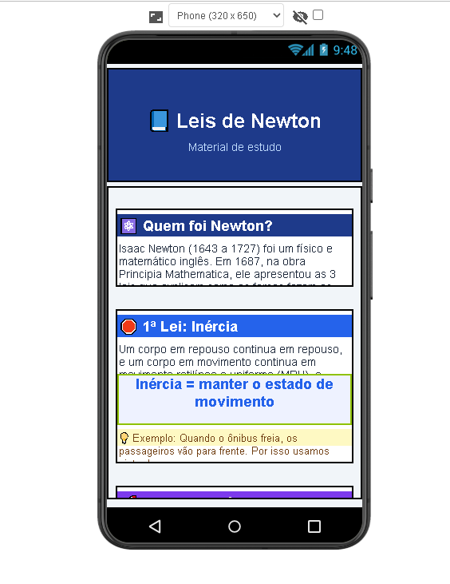
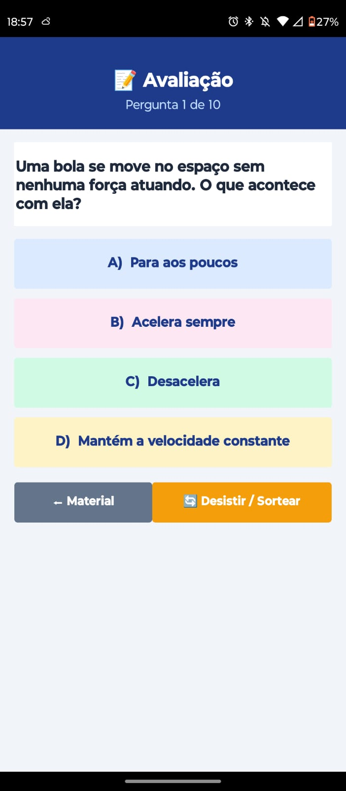
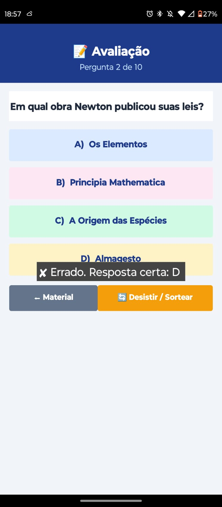
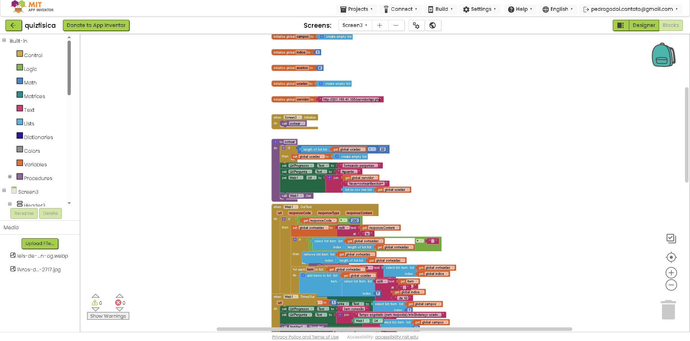
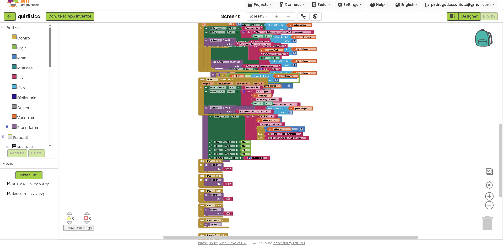

# Relatório: Quiz de Leis de Newton (MIT App Inventor)

* **Instituição:** Etec Vasco Antônio Venchiarutti
* **Disciplina:** Desenvolvimento para Dispositivos Móveis (DDM)
* **Turma:** 2º D, 4º bimestre
* **Dupla:** Laura Cristina e Pedro Godoi
* **Assunto:** Leis de Newton (Física)

---

## Apresentação

Fizemos um app de estudo e avaliação sobre as **Leis de Newton** (Inércia, Princípio Fundamental da Dinâmica e Ação e Re reação). O app tem duas partes principais: um material de estudo, com explicações, fórmulas e exemplos práticos, e uma avaliação com 10 questões sorteadas de um banco de 30, sem repetir.

O app foi montado no **MIT App Inventor**. A interface visual é uma página web (HTML, CSS e JavaScript) que roda dentro de um componente *WebViewer*. As questões ficam armazenadas em um banco de dados MySQL e são servidas por uma API em PHP rodando no XAMPP.

---

## Objetivo

* Ajudar o aluno a revisar o conteúdo de Física antes de fazer a avaliação.
* Aplicar uma prova curta e dinâmica, com questões diferentes a cada tentativa.
* Mostrar a nota obtida, a correção detalhada de cada questão com a respectiva resolução e o histórico de tentativas.
* Praticar a comunicação integrada entre um aplicativo móvel (App Inventor) e um servidor web com banco de dados MySQL.

---

## Como o App Funciona

### 1. Material de Estudo
A tela inicial apresenta o tema e o acesso ao material de estudo teórico. Ela explica detalhadamente as Leis de Newton com fórmulas e exemplos cotidianos. No fim da seção, há o botão para iniciar a avaliação.

* **Design do Aplicativo (Tela de Estudo):**
  

### 2. Avaliação
Ao iniciar, o aplicativo solicita ao servidor 10 questões sorteadas aleatoriamente do banco total de 30 questões. É possível navegar entre as perguntas, e o estado da prova pode ser salvo ou reiniciado caso o usuário deseje desistir e sortear um novo bloco de questões.

* **Exemplo de Questão na Avaliação:**
  
  

### 3. Resultado e Revisão
Após concluir todas as perguntas, o servidor realiza a correção e devolve a pontuação final. O app exibe o total de acertos, mensagens de incentivo e a revisão detalhada de cada alternativa.

* **Tela de Conclusão da Prova:**
  

---

## Parte do App Inventor

### Designer
A tela principal (`Screen3`) utiliza componentes essenciais para a integração web e salvamento local:

| Componente | Tipo | Para que serve |
| :--- | :--- | :--- |
| **Interface** | WebViewer | Mostra a página web do aplicativo (`index.html`, `app.js` e os arquivos CSS). |
| **Web** | WebAPI | Realiza os pedidos HTTP para o arquivo `api.php` hospedado no XAMPP. |
| **Armazenamento** | TinyDB | Guarda localmente no celular o estado atual do aplicativo (prova em andamento e histórico). |

*Nota: Os arquivos da interface web (HTML, JS, CSS, mídias e fontes) foram enviados para a pasta Media do projeto.*

### Blocos
A página web e os blocos do App Inventor conversam através de mensagens em formato **JSON**. A página envia requisições utilizando a propriedade `WebViewString`, e os blocos processam o campo `action` correspondente:

* **`load`**: Lê o estado salvo no TinyDB (na tag `estado`) e devolve para a página web por meio da função `window.QMRestore(...)`.
* **`store`**: Salva o estado recebido da interface utilizando a função `StoreValue`.
* **`request`**: Armazena o ID do pedido, configura a URL no componente `WebAPI` e executa requisições do tipo *Get* ou *PostText*.

Quando o servidor responde com sucesso (`WebAPI.GotText`), os blocos acionam a função `window.QMNativeReceive(id, código, resposta)` na página. Caso ocorra tempo esgotado (`WebAPI.TimedOut`), uma mensagem de erro é tratada. No evento `Screen3.Initialize`, o componente `WebAPI` é configurado para trafegar dados no padrão `application/json`.

* **Estrutura de Blocos no App Inventor:**
  
  

---

## Servidor (PHP + MySQL)

A API localizada em `servidor/api.php` foi adaptada a partir do material base fornecido em aula e responde estruturadamente em JSON através das seguintes ações:
* **`health`**: Verifica se a conexão com o banco está ativa e retorna a quantidade de questões cadastradas.
* **`start`**: Sorteia 10 questões exclusivas e inicializa uma nova tentativa.
* **`save`**: Salva as marcações e os dados enviados pelo app.
* **`finish`**: Efetua a correção definitiva da prova e retorna a nota final.
* **`session`**: Localiza uma tentativa anterior utilizando um código de token específico.

O banco de dados `quiz_media` é composto por três tabelas principais:
1. `questions`: Guarda as 30 questões (enunciado, alternativas, gabarito e resolução).
2. `attempts`: Armazena os dados de cada tentativa realizada (código, horários de início/fim, nota e tempo gasto).
3. `attempt_questions`: Relaciona as 10 questões respondidas em cada tentativa específica.

*Segurança:* O gabarito com a alternativa correta permanece exclusivamente no servidor, sendo liberado apenas após a conclusão da avaliação.

---

## Testes Realizados

O ambiente foi configurado utilizando o servidor local XAMPP (`htdocs/QuizMedia`), onde realizamos validações completas no navegador, em simuladores de dispositivos móveis e diretamente integrados ao MIT App Inventor. Foram testados:
* O algoritmo de sorteio de 10 questões sem repetição.
* A navegação fluida entre perguntas.
* O processo de correção automática, exibição de notas e revisão de conteúdos.
* A alteração dinâmica do endereço IP da API na aba de informações para testes em celulares reais na rede local.

---

## Conclusão

O desenvolvimento deste projeto permitiu consolidar os conhecimentos adquiridos na disciplina de DDM, unindo o desenvolvimento mobile em blocos com conceitos modernos de tecnologias web. Compreendemos profundamente como uma interface HTML/JS integrada em um *WebViewer* interage via JSON com blocos nativos e consome uma API backend em PHP conectada a um banco MySQL, aplicando tudo isso a um contexto educacional prático voltado ao ensino de Física.
