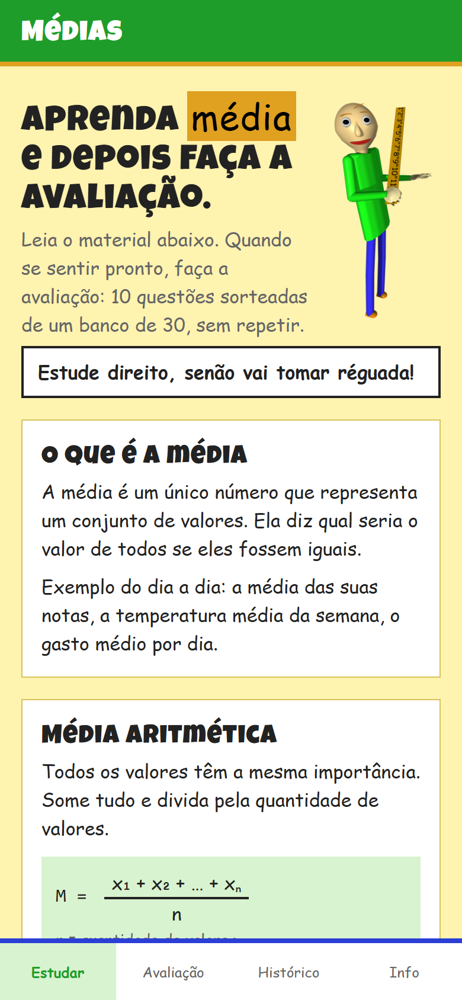
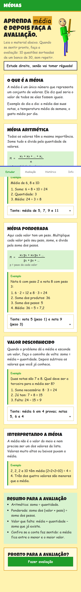
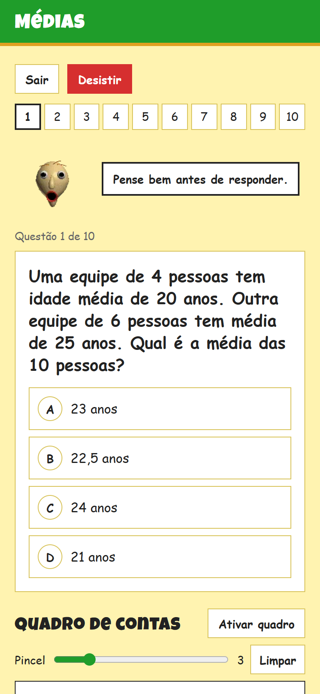
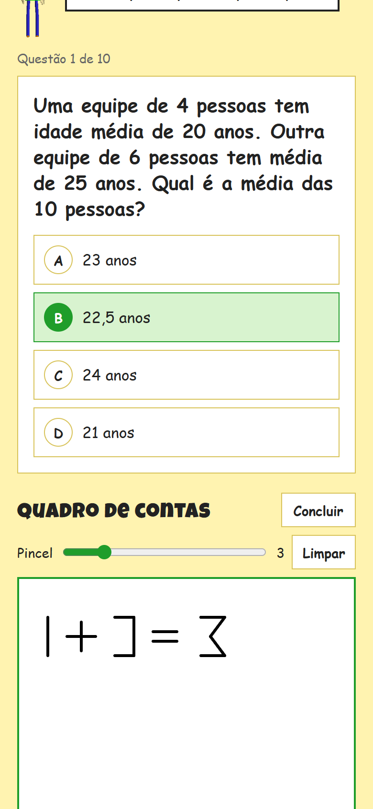
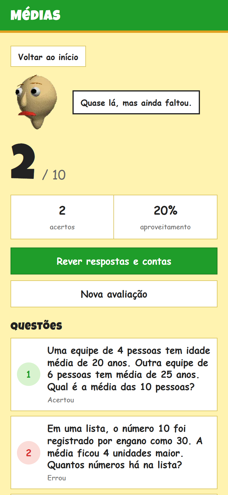
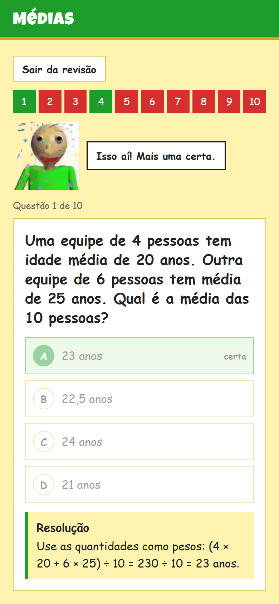
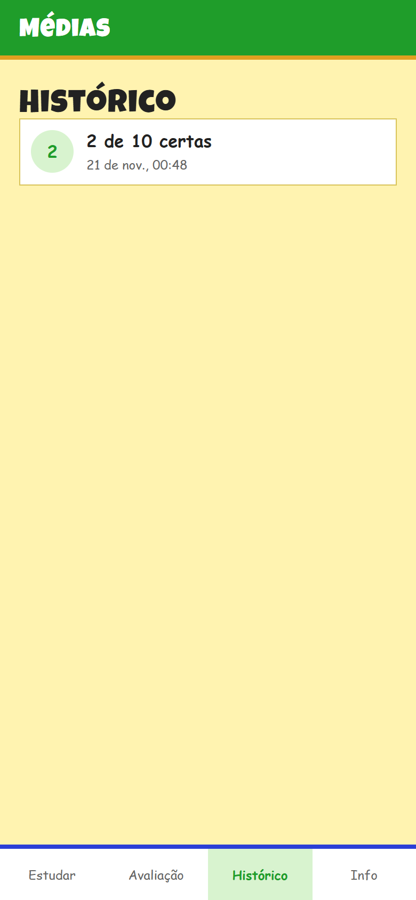
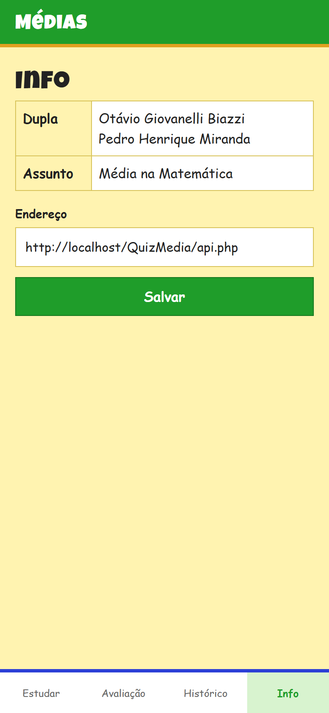
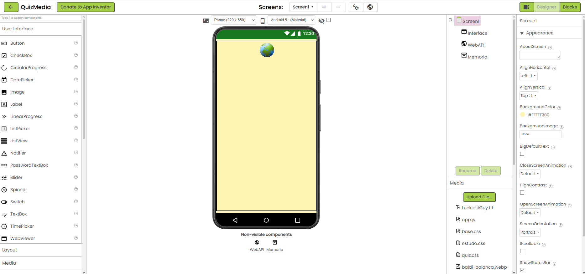
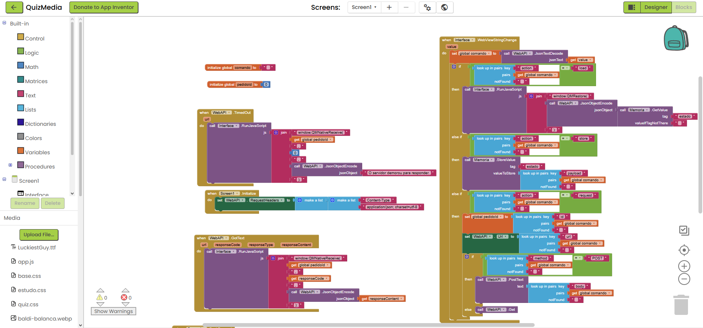

# Relatório: Quiz de Médias (MIT App Inventor)

**Instituição:** Etec Vasco Antônio Venchiarutti  
**Disciplina:** Desenvolvimento para Dispositivos Móveis (DDM)  
**Turma:** 2º D, 4º bimestre  
**Dupla:** Otávio Giovanelli Biazzi e Pedro Henrique Miranda  
**Assunto:** Média na Matemática

## Apresentação

Fizemos um app de estudo e avaliação sobre **médias** (aritmética, ponderada e situações do dia a dia). O app tem duas partes: um **material de estudo**, com explicações, fórmulas e exemplos, e uma **avaliação** com 10 questões sorteadas de um banco de 30, sem repetir. Para deixar o app mais divertido, usamos o personagem **Baldi**, que reage com gifs e falas diferentes conforme o aluno acerta, erra ou termina a prova.

O app foi montado no **MIT App Inventor**. A tela é uma página web (HTML, CSS e JavaScript) que roda dentro de um componente WebViewer. As questões ficam num banco MySQL e são servidas por uma API em PHP no XAMPP.

## Objetivo

- Ajudar o aluno a revisar o conteúdo de médias antes de fazer a prova.
- Aplicar uma avaliação curta, com questões diferentes a cada tentativa.
- Mostrar a nota, a correção de cada questão com a resolução e o histórico de tentativas.
- Praticar a comunicação entre um app de celular e um servidor com banco de dados.

## Como o app funciona

### 1. Material de estudo

A primeira tela é a de estudo. Ela explica o que é média, a média aritmética e a ponderada, com fórmulas e exemplos do dia a dia. O Baldi aparece com falas como "Estude direito, senão vai tomar reguada!". No fim da tela fica o botão para começar a avaliação.

| Início | Tela de estudo completa |
| :----: | :---------------------: |
|  |  |

### 2. Avaliação

Ao começar, o app pede ao servidor 10 questões sorteadas do banco de 30. A barra numerada no topo permite pular entre as questões, e a questão atual fica marcada. O Baldi muda de expressão a cada resposta. Dá para **sair** e continuar depois, porque a prova fica salva no aparelho, ou **desistir**. Quem desiste recebe outras questões no próximo sorteio.

| Questão | Quadro de contas |
| :-----: | :--------------: |
|  |  |

O **quadro de contas** é uma área de desenho embaixo de cada questão, onde o aluno faz as contas com o dedo, como num rascunho. O desenho é salvo junto com a resposta e aparece de novo na revisão.

### 3. Resultado e revisão

Ao concluir, o servidor corrige a prova e devolve a nota. O app mostra a quantidade de acertos, o aproveitamento e a lista das questões certas e erradas. Na revisão, cada questão mostra a alternativa certa e a **resolução**.

| Resultado | Revisão com resolução |
| :-------: | :-------------------: |
|  |  |

### 4. Histórico e Info

O **Histórico** guarda as avaliações feitas, com a nota e a data. Clicando numa delas, dá para rever a prova. A aba **Info** mostra a dupla e o assunto e permite trocar o endereço da API, o que é necessário para usar o app no celular com o IP do computador onde o XAMPP está rodando.

| Histórico | Info |
| :-------: | :--: |
|  |  |

## Parte do App Inventor

### Designer

A tela `Screen1` tem três componentes:

| Componente | Tipo | Para que serve |
| ---------- | ---- | -------------- |
| `Interface` | WebViewer | Mostra a página do app (`index.html`, `app.js` e os CSS) |
| `WebAPI` | Web | Faz os pedidos HTTP para o `api.php` no XAMPP |
| `Memoria` | TinyDB | Guarda no celular o estado do app (prova em andamento e histórico) |

Os arquivos da página (HTML, JS, CSS, gifs e a fonte LuckiestGuy) foram enviados em **Media**.

### Blocos

A página e os blocos conversam por **mensagens em JSON**. A página envia um pedido com `WebViewString`, e os blocos leem o campo `action` para decidir o que fazer:

| `action` | O que os blocos fazem |
| -------- | --------------------- |
| `load` | Leem o estado salvo na `Memoria` (tag `estado`) e devolvem para a página com `window.QMRestore(...)` |
| `store` | Salvam o estado recebido na `Memoria` com `StoreValue` |
| `request` | Guardam o `id` do pedido, colocam a `url` no `WebAPI` e fazem `PostText` (se o método for POST) ou `Get` |

Quando o servidor responde (`WebAPI.GotText`), os blocos chamam `window.QMNativeReceive(id, código, resposta)` na página. Se o servidor demorar (`WebAPI.TimedOut`), devolvem uma mensagem de erro. No `Screen1.Initialize`, o `WebAPI` é configurado para enviar os dados em JSON (`Content-Type: application/json`).

Escolhemos esse caminho porque, dentro do App Inventor, quem faz o pedido ao servidor é o próprio app (componente Web). No navegador do computador, a página usa `fetch` direto, e por isso dá para testar o app inteiro no PC antes de passar para o celular.

## Servidor (PHP + MySQL)

A API `servidor/api.php` foi adaptada do material **AgendaServer** do professor e responde sempre em JSON:

| Ação | O que faz |
| ---- | --------- |
| `health` | Diz se o banco está funcionando e quantas questões existem |
| `start` | Sorteia 10 questões (evitando as da última tentativa desistida) e cria uma tentativa |
| `save` | Salva as respostas e os desenhos do quadro |
| `finish` | Corrige a prova e devolve a nota |
| `session` | Busca uma tentativa pelo código (token) |

O banco `quiz_media` tem três tabelas:

| Tabela | O que guarda |
| ------ | ------------ |
| `questions` | As 30 questões: enunciado, alternativas, alternativa certa e resolução |
| `attempts` | Cada tentativa: código, início, fim, nota e tempo gasto |
| `attempt_questions` | As 10 questões de cada tentativa, a resposta marcada e o desenho do quadro |

A alternativa certa fica só no servidor e só é enviada depois que a prova é concluída. Assim, não dá para descobrir as respostas olhando o código da página durante a prova.

## Testes realizados

Instalamos o servidor no XAMPP (`htdocs/QuizMedia`), criamos o banco com os arquivos da pasta `sql/` e testamos no navegador, em tamanho de celular, e no App Inventor. Conferimos:

- o sorteio de 10 questões sem repetir;
- a troca de questão pela barra numerada e pelos botões;
- o quadro de contas (desenhar, mudar o pincel e limpar);
- a correção, a nota e a revisão com a resolução;
- o histórico depois de mais de uma tentativa;
- a mudança do endereço da API na aba Info.

Os prints deste relatório foram tirados durante esses testes.

## Conclusão

O projeto juntou o que aprendemos em DDM com o que já sabíamos de web. Entendemos como um app do App Inventor pode usar uma página web como interface, como os blocos trocam mensagens com o JavaScript e como o app conversa com um servidor PHP e um banco MySQL. Também aprendemos a pensar no conteúdo de matemática de um jeito que ajude outro aluno a estudar.

---

As ferramentas de IA utilizadas estão na **DECLARAÇÃO DE USO DE INTELIGÊNCIA ARTIFICIAL**, no [README](README.md) desta pasta.
